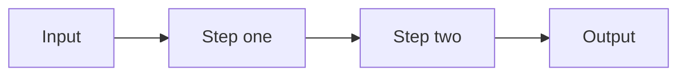

<!--
  README TEMPLATE (full)

  1. Replace every {{PLACEHOLDER}}.
  2. Delete sections marked OPTIONAL that don't fit, heading included.
     Never leave an empty heading or filler like "License details" behind.
  3. Delete all the HTML comments, this one included. They don't render on GitHub.
  4. Run:  grep -n '{{[A-Z]' README.md
     It should print nothing. Anything it prints is a placeholder you missed.

  Which optional sections to keep:
    CLI / TUI tool   Commands, Keybindings, Configuration, Environment variables, Troubleshooting
    Library          Examples (as code), How it works; drop Commands and Keybindings
    Dotfiles         Tech stack, Project structure, Keybindings, Files it creates, Uninstall, Troubleshooting
    Touches user data or the network   add Privacy and safety
    Small script     Use README_TEMPLATE_LITE.md instead

  The order follows the questions a visitor asks:
  what is it > why care > how to get it > how to use it > how it works > how to help > can I use it
-->

<a id="readme-top"></a>

<div align="center">

<!-- Two logo files keep it visible in light and dark mode. Only have one? Delete the <source> line. -->
<picture>
  <source media="(prefers-color-scheme: dark)" srcset="docs/assets/logo-on-dark.svg" />
  
</picture>

# {{PROJECT_NAME}}

**{{ONE_LINE_PITCH}}**

<!--
  Badges: 3 to 5, one row, one color family.
  Delete the Build badge if the repo has no GitHub Actions workflow called ci.yml,
  or it will show "not found".
  Logo slugs come from https://simpleicons.org.
  In static badges, write a dash as -- and a space as _ (e.g. Arch_Linux).
-->
[](https://github.com/{{OWNER}}/{{REPO}}/releases)
[](https://github.com/{{OWNER}}/{{REPO}}/actions)
[](LICENSE)


<!-- Link only to sections that still exist. -->
[Quick start](#quick-start) · [Usage](#usage) · [Documentation](#documentation) · [Contributing](#contributing)

</div>

<br/>

<!-- A screenshot, GIF, or SVG terminal recording of the main job being done. Same light/dark trick as the logo. -->
<p align="center">
  <picture>
    <source media="(prefers-color-scheme: dark)" srcset="docs/assets/demo-dark.png" />
    
  </picture>
</p>

<!--
  OPTIONAL: one callout, not five. Use it for whichever matters most right now:
    a release         "{{VERSION}} is out. See the changelog."
    project status    "Early development: expect breaking changes before 1.0."
    maintenance       "No longer maintained. Use {{ALTERNATIVE}} instead."
-->
> [!NOTE]
> **{{VERSION}} is out** ({{RELEASE_DATE}}). See the [changelog](CHANGELOG.md) for what changed.

## Overview

<!-- 2 to 4 sentences. What it is, who it's for, and what's different about it. -->

{{PROJECT_NAME}} is a {{TYPE_OF_TOOL}} for {{AUDIENCE}}. It {{MAIN_JOB}} by {{HOW}}, so you can {{OUTCOME}} without {{PAIN_POINT}}.

### Features

<!-- 3 to 6 bullets. Bold the benefit, then the specific detail that backs it up. -->

- **{{BENEFIT_ONE}}.** {{DETAIL: a number, a limit, or what it handles}}
- **{{BENEFIT_TWO}}.** {{DETAIL}}
- **{{BENEFIT_THREE}}.** {{DETAIL}}

## Why {{PROJECT_NAME}}

<!-- OPTIONAL. Use it when the problem isn't obvious. Problem first, then your approach. -->

{{THE_SITUATION_THE_READER_IS_IN_TODAY}}

```text
{{ONE_CONCRETE_EXAMPLE: a leaked .env, a full disk, a broken config}}
```

{{PROJECT_NAME}} handles this differently: {{ONE_SENTENCE_APPROACH}}

<!-- OPTIONAL: if well-known alternatives exist, readers will compare anyway. Say what they do well and where this differs. -->
{{HOW_IT_DIFFERS_FROM_ALTERNATIVES}}

> **{{THE_CORE_IDEA_IN_ONE_LINE}}**

## Requirements

| Requirement | Details |
| :--- | :--- |
| **OS** | {{OS_AND_ARCHITECTURES}} |
| **Runtime** | {{RUNTIME_AND_MIN_VERSION}} |
| **Optional** | `{{TOOL}}` for {{FEATURE}} |

## Installation

```bash
{{INSTALL_COMMAND}}
```

<details>
<summary><b>Other install methods</b></summary>

<br/>

**From source**

```bash
git clone https://github.com/{{OWNER}}/{{REPO}}.git
cd {{REPO}}
{{BUILD_OR_INSTALL_SCRIPT}}
```

**{{OTHER_PACKAGE_MANAGER}}**

```bash
{{OTHER_INSTALL_COMMAND}}
```

</details>

### Updating

```bash
{{UPDATE_COMMAND}}
```

### Uninstalling

<!-- OPTIONAL. Worth it for anything that writes outside its own folder (dotfiles, system services). -->

```bash
{{UNINSTALL_COMMAND}}
```

<!-- OPTIONAL: the one thing that can hurt the user if they get it wrong. -->
> [!WARNING]
> {{THE_ONE_THING_NOT_TO_DO}}

## Quick start

<!-- The shortest path from install to a useful result. Comment every line. -->

```bash
{{CLI}} init              # set up a new project
{{CLI}} run {{PATH}}      # do the main thing
{{CLI}} status            # check the result
```

## Usage

### Commands

| Command | Description |
| :--- | :--- |
| `{{CLI}} init` | {{WHAT_IT_DOES}} |
| `{{CLI}} run [PATH]` | {{WHAT_IT_DOES}} `--{{FLAG}}` changes {{BEHAVIOR}}. |
| `{{CLI}} --help` | List every command and option. |

<!-- OPTIONAL for CLIs: exit codes, e.g. `0` success, `1` {{FAILURE_KIND}}, `2` input error. -->

### Keybindings

<!-- OPTIONAL: for TUIs, window managers, and editors. -->

| Key | Action |
| :--- | :--- |
| `j` / `k` | Move down / up |
| `Enter` | Open the selected item |
| `/` | Search |
| `?` | Show all keybindings |
| `q` | Quit |

### Examples

<!-- OPTIONAL: 1 to 3 real tasks. Name the task, then show the code. For a library, show an import and a call. -->

**{{TASK_NAME}}**

```bash
{{EXAMPLE_COMMAND}}
```

## Configuration

Settings live in `{{CONFIG_PATH}}`. Every key is optional.

```toml
[{{SECTION}}]
{{KEY}} = "{{VALUE}}"    # what it controls (default: {{DEFAULT}})
```

The full reference is in [docs/configuration.md](docs/configuration.md).

### Environment variables

<!-- OPTIONAL. Keep the NO_COLOR row only if you support it (https://no-color.org). -->

| Variable | Effect |
| :--- | :--- |
| `{{ENV_VAR}}` | {{WHAT_IT_CHANGES}} |
| `NO_COLOR` | Turns off colored output. |

### Files it creates

<!-- OPTIONAL, but important for anything that writes outside its own folder. Say what gets replaced and where the backups go. -->

| Path | Contents |
| :--- | :--- |
| `{{CONFIG_PATH}}` | Settings |
| `{{DATA_PATH}}` | {{WHAT_IS_STORED}} |
| `{{BACKUP_PATH}}` | Backups of files the installer replaced |

## Privacy and safety

<!-- OPTIONAL. For anything that touches user files, credentials, or the network. Plain statements a user can check. -->

- {{NETWORK_AND_TELEMETRY: e.g. "makes no network requests and collects no telemetry"}}
- {{WHAT_IT_NEVER_DOES_WITHOUT_ASKING}}
- {{HOW_TO_UNDO_A_CHANGE}}

## How it works

<!-- OPTIONAL. One diagram and a short paragraph. GitHub renders Mermaid natively. -->



{{ONE_PARAGRAPH_ON_THE_FLOW_AND_THE_KEY_DESIGN_DECISION}}

## Tech stack

<!-- OPTIONAL. Link every tool so readers can follow up. -->

| Component | Tool |
| :--- | :--- |
| **{{ROLE}}** | [{{TOOL}}]({{LINK}}) |
| **{{ROLE}}** | [{{TOOL}}]({{LINK}}) |

## Project structure

```text
.
├── src/          # application code
├── tests/        # unit and integration tests
├── docs/         # extended documentation
├── scripts/      # helper scripts
└── README.md
```

## Development

<!-- OPTIONAL: if the repo has design notes or an AGENTS.md, point new contributors there first. -->
Read [docs/architecture.md](docs/architecture.md) and [AGENTS.md](AGENTS.md) before making changes.

```bash
git clone https://github.com/{{OWNER}}/{{REPO}}.git
cd {{REPO}}
{{INSTALL_DEPS_COMMAND}}     # install dependencies
{{TEST_COMMAND}}             # run the tests
{{LINT_COMMAND}}             # lint and format checks
```

## Troubleshooting

<!-- OPTIONAL. One collapsible block per real problem people have hit. -->

<details>
<summary><b>{{SYMPTOM_THE_USER_SEES}}</b></summary>

<br/>

{{CAUSE}}. Fix it with:

```bash
{{FIX_COMMAND}}
```

</details>

## Limitations

<!-- OPTIONAL, but honest limits earn more trust than any badge. -->

- {{LIMITATION}}
- {{LIMITATION}}

## Roadmap

<!-- OPTIONAL -->

- [x] {{SHIPPED_FEATURE}}
- [ ] {{PLANNED_FEATURE}}

## Documentation

| Guide | What's in it |
| :--- | :--- |
| [Installation](docs/install.md) | Manual setup and troubleshooting |
| [Configuration](docs/configuration.md) | Every option and its default |
| [Architecture](docs/architecture.md) | How the pieces fit together |

## Contributing

Issues and pull requests are welcome. Read [CONTRIBUTING.md](CONTRIBUTING.md) before opening a PR, and use [GitHub Issues](https://github.com/{{OWNER}}/{{REPO}}/issues) for bugs and feature requests.

<!-- OPTIONAL: only if Discussions is turned on in the repo settings. -->
Questions and ideas go in [Discussions](https://github.com/{{OWNER}}/{{REPO}}/discussions).

## Security

Please don't report security problems in public issues. [SECURITY.md](SECURITY.md) explains how to report them privately.

## License

Released under the [{{LICENSE_NAME}}](LICENSE).

<!-- OPTIONAL: Bundled third-party components keep their own licenses; see [THIRD_PARTY_NOTICES](THIRD_PARTY_NOTICES). -->

## Acknowledgements

<!-- OPTIONAL -->

- [{{PROJECT}}]({{LINK}}) for {{WHAT_IT_GAVE_YOU}}

<br/>

<div align="center">
  <sub>Built by <a href="https://github.com/{{OWNER}}">{{OWNER}}</a> · <a href="#readme-top">Back to top</a></sub>
</div>
