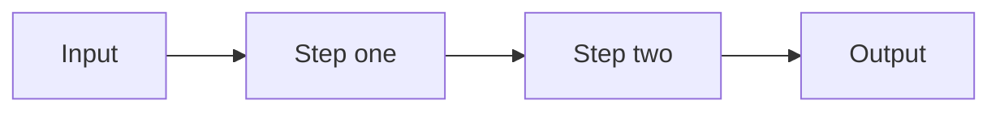

<!--
  README TEMPLATE

  How to use it:
  1. Replace the placeholders: PROJECT_NAME, OWNER, REPO, PACKAGE, COMMAND,
     and anything else written in CAPS.
  2. Sections marked OPTIONAL can go. Delete the whole section, heading included.
     Never leave an empty heading or filler like "License details" behind.
  3. These HTML comments don't render on GitHub. Delete them when you're done.

  The order follows the questions a visitor asks:
  What is it? > Why should I care? > How do I get it? > How do I use it?
  > How does it work? > How do I work on it? > Can I use it?
-->

<a id="readme-top"></a>

<div align="center">


# PROJECT_NAME

**One line that says what it does and who it's for.**

<!--
  Badges: pick 3 to 5 and keep them on one row.
  Logos come from https://simpleicons.org (use the slug, e.g. rust, python, archlinux).
  Use one color family across all badges so the row looks deliberate.
-->
[](https://github.com/OWNER/REPO/releases)
[](https://github.com/OWNER/REPO/actions)
[](LICENSE)
[](#tech-stack)

[Quick start](#quick-start) · [Usage](#usage) · [Documentation](#documentation) · [Contributing](#contributing)

</div>

<br/>

<!-- A screenshot, GIF, or SVG terminal recording showing the main job being done. -->
<p align="center">
  
</p>

<!-- OPTIONAL: one callout for a release, a breaking change, or project status. One, not five. -->
> [!NOTE]
> **vX.Y.Z is out** (YYYY-MM-DD). See the [changelog](CHANGELOG.md) for what changed.

## Overview

<!-- 2 to 4 sentences. What it is, who it's for, and what's different about it. -->

PROJECT_NAME is a TYPE_OF_TOOL for AUDIENCE. It DOES_THE_MAIN_THING by HOW_IT_DOES_IT, so you can OUTCOME without PAIN_POINT.

### Features

<!-- 3 to 6 bullets. Bold the benefit, then the specific detail that backs it up. -->

- **Benefit one.** The concrete detail behind it: a number, a limit, what it handles.
- **Benefit two.** The concrete detail behind it.
- **Benefit three.** The concrete detail behind it.

## Why PROJECT_NAME

<!-- OPTIONAL. Use it when the problem isn't obvious. Problem first, then your approach. -->

Describe the situation the reader is in today, with one concrete example:

```text
THE_MESSY_THING (a leaked .env, a full disk, a broken config)
```

PROJECT_NAME handles this differently: ONE_SENTENCE_APPROACH.

> **THE CORE IDEA IN ONE LINE.**

## Requirements

| Requirement | Details |
| :--- | :--- |
| **OS** | Linux (x86-64, ARM64) |
| **Runtime** | RUNTIME VERSION+ |
| **Optional** | `tool-a` for FEATURE, `tool-b` for FEATURE |

## Installation

```bash
PACKAGE_MANAGER install PACKAGE
```

<details>
<summary><b>Other install methods</b></summary>

<br/>

**From source**

```bash
git clone https://github.com/OWNER/REPO.git
cd REPO
./install.sh
```

**PACKAGE_MANAGER_TWO**

```bash
PACKAGE_MANAGER_TWO install PACKAGE
```

</details>

### Updating

```bash
PACKAGE_MANAGER update PACKAGE
```

<!-- OPTIONAL: anything that can hurt the user if they get it wrong. -->
> [!WARNING]
> THE ONE THING NOT TO DO (e.g. "Don't run the installer with sudo").

## Quick start

<!-- The shortest path from install to a useful result. Comment every line. -->

```bash
COMMAND init              # set up a new project
COMMAND run PATH          # do the main thing
COMMAND status            # check the result
```

## Usage

### Commands

| Command | Description |
| :--- | :--- |
| `COMMAND init` | Create a new project in the current directory. |
| `COMMAND run [PATH]` | Do the main thing. `--flag` changes BEHAVIOR. |
| `COMMAND status` | Show the current state. |
| `COMMAND --help` | List every command and option. |

<!-- OPTIONAL for CLIs: exit codes, e.g. `0` success, `1` FAILURE_KIND, `2` input error. -->

### Keybindings

<!-- OPTIONAL: for TUIs, window managers, and editors. -->

| Key | Action |
| :--- | :--- |
| `j` / `k` | Move down / up |
| `Enter` | Open the selected item |
| `/` | Search |
| `?` | Show all keybindings |
| `q` | Quit |

### Examples

<!-- OPTIONAL: 1 to 3 real tasks. Name the task, then show the command. -->

**TASK_NAME**

```bash
COMMAND run ./data --format json > out.json
```

## Configuration

Settings live in `~/.config/PROJECT_NAME/config.toml`. Every key is optional.

```toml
[SECTION]
KEY = "VALUE"    # what it controls (default: DEFAULT)
```

The full reference is in [docs/configuration.md](docs/configuration.md).

## How it works

<!-- OPTIONAL. One diagram and a short paragraph. GitHub renders Mermaid natively. -->



One paragraph on the flow and the design decision that matters most.

## Tech stack

<!-- OPTIONAL. Link every tool so readers can follow up. -->

| Component | Tool |
| :--- | :--- |
| **Language** | [LANGUAGE](https://LINK) |
| **Framework** | [FRAMEWORK](https://LINK) |
| **Storage** | [DATABASE](https://LINK) |

## Project structure

```text
.
├── src/          # application code
├── tests/        # unit and integration tests
├── docs/         # extended documentation
├── scripts/      # helper scripts
└── README.md
```

## Development

```bash
git clone https://github.com/OWNER/REPO.git
cd REPO
INSTALL_DEPS_COMMAND     # install dependencies
TEST_COMMAND             # run the tests
LINT_COMMAND             # lint and format checks
```

## Limitations

<!-- OPTIONAL, but honest limits earn more trust than any badge. -->

- Only supports PLATFORM for now.
- KNOWN_EDGE_CASE behaves like THIS.

## Roadmap

<!-- OPTIONAL -->

- [x] Shipped feature
- [ ] Planned feature
- [ ] Planned feature

## Documentation

| Guide | What's in it |
| :--- | :--- |
| [Installation](docs/install.md) | Manual setup and troubleshooting |
| [Configuration](docs/configuration.md) | Every option and its default |
| [Architecture](docs/architecture.md) | How the pieces fit together |

## Contributing

Issues and pull requests are welcome. Read [CONTRIBUTING.md](CONTRIBUTING.md) before opening a PR, and use [GitHub Issues](https://github.com/OWNER/REPO/issues) for bugs and feature requests.

## Security

Please don't report security problems in public issues. [SECURITY.md](SECURITY.md) explains how to report them privately.

## License

Released under the [LICENSE_NAME](LICENSE).

<!-- OPTIONAL: Bundled third-party components keep their own licenses; see [THIRD_PARTY_NOTICES](THIRD_PARTY_NOTICES). -->

## Acknowledgements

<!-- OPTIONAL -->

- [PROJECT](https://LINK) for WHAT_IT_GAVE_YOU

<br/>

<div align="center">
  <sub>Built by <a href="https://github.com/OWNER">OWNER</a> · <a href="#readme-top">Back to top</a></sub>
</div>
